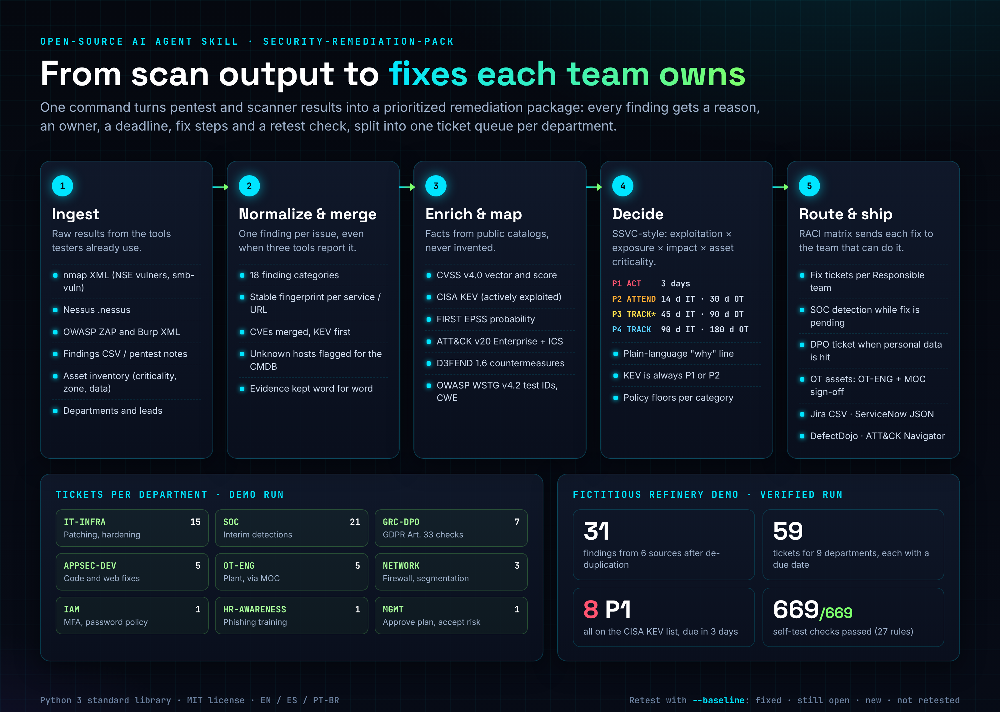
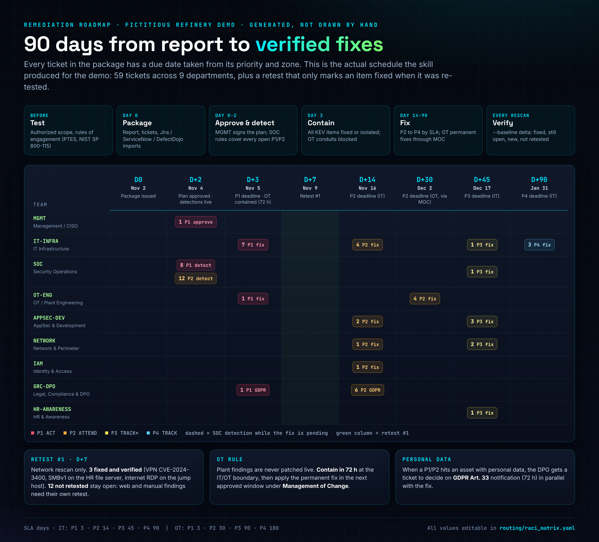
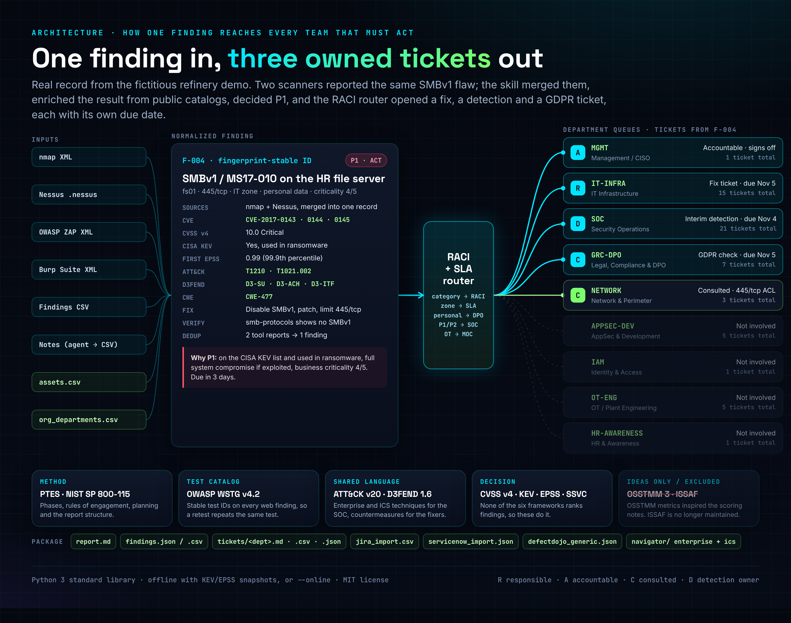

# security-remediation-pack

Idiomas: [English](README.md) | **Español** | [Português (Brasil)](README.pt-BR.md)


Una skill de agente de IA de código abierto que convierte la salida de un pentest y de los escáneres en un paquete de remediación con el que cada departamento puede actuar: un informe para la dirección y una cola de tickets por equipo, y cada hallazgo con su motivo, su responsable, su plazo, los pasos de corrección y la comprobación de retest.

Un test solo sirve cuando la corrección se aplica. La mayoría de los informes se quedan en "aquí tienes 31 vulnerabilidades". Esta skill llega hasta "Infraestructura IT tiene 7 parches P1 para el jueves, el SOC tiene 20 detecciones provisionales para el miércoles, el DPO debe valorar una notificación RGPD y el equipo de planta contiene dos exposiciones de PLC mediante gestión del cambio (MOC)".



## Inicio rápido

```bash
git clone {{GITHUB_URL}} security-remediation-pack
cd security-remediation-pack
bash examples/novarefino/run_example.sh      # genera el paquete de demo y ejecuta el autotest
```

Con tus propios resultados:

```bash
python3 scripts/remediation_pack.py \
  --nmap scan.xml --nessus scan.nessus --zap zap.xml --burp burp.xml --findings manual.csv \
  --assets assets.csv --org org_departments.csv \
  --kev known_exploited_vulnerabilities.json --epss epss.json \
  --company "Example Corp" --scope "Perímetro externo y LAN corporativa" \
  --lang es --out out/
python3 scripts/selftest.py out/ --org org_departments.csv
```

- Solo la biblioteca estándar de Python 3. Sin pip install.
- Funciona sin conexión con copias locales de KEV y EPSS, o con `--online` para descargarlas en directo.
- `--lang es` o `--lang pt-BR` genera el informe y los tickets en español o portugués de Brasil.
- `--baseline out/findings.json` en una ejecución posterior genera el delta de retest.

Para usarla como skill de agente, copia la carpeta en el directorio de skills de tu agente. El agente lee [SKILL.md](i18n/es/SKILL.md), que le indica cuándo usarla, qué pedir, cómo ejecutarla y qué reglas seguir.

## Cómo funciona

1. **Ingesta.** Parsers para nmap XML, Nessus, OWASP ZAP, Burp Suite y un CSV genérico de hallazgos. El agente convierte las notas del pentest a ese CSV. Un inventario de activos aporta criticidad, zona, exposición a internet y tipo de datos.
2. **Normalización y fusión.** Un hallazgo por problema y servicio, con una huella estable. Si nmap y Nessus detectan el mismo fallo SMBv1, obtienes un hallazgo con dos fuentes, no dos tickets.
3. **Enriquecimiento y mapeo.** Vector y puntuación CVSS v4, CISA KEV (incluido el uso en ransomware), FIRST EPSS, técnicas MITRE ATT&CK v20 Enterprise e ICS, contramedidas D3FEND, IDs de prueba OWASP WSTG v4.2 y CWE. Los datos que faltan se señalan, nunca se inventan.
4. **Decisión.** Una decisión estilo SSVC (explotación, exposición, impacto técnico, criticidad del activo) da ACT, ATTEND, TRACK* o TRACK, que se traducen en P1 a P4. Lo que está en KEV siempre es P1 o P2. Cada hallazgo lleva una línea de "por qué" en lenguaje claro.
5. **Enrutado y entrega.** Una matriz RACI ([routing/raci_matrix.yaml](routing/raci_matrix.yaml)) asigna cada categoría a un equipo responsable, fija el SLA por zona, envía al DPO los hallazgos con datos personales, abre una detección provisional en el SOC para los P1/P2 abiertos y dirige los hallazgos OT a ingeniería de planta y MOC.



| Prioridad | Decisión | SLA IT | SLA OT |
|---|---|---|---|
| P1 | ACT | 3 días | 3 días (contener en 72 h, corrección definitiva vía MOC) |
| P2 | ATTEND | 14 días | 30 días |
| P3 | TRACK* | 45 días | 90 días |
| P4 | TRACK | 90 días | 180 días |



## Qué obtienes

| Archivo | Para |
|---|---|
| `report.md` | Dirección: resumen, tabla de prioridades, el "por qué" de cada hallazgo, carga por departamento, delta de retest |
| `tickets/<DEPT>.md / .csv / .json` | Cada departamento recibe solo su trabajo |
| `findings.json` / `findings.csv` | Todos los datos normalizados |
| `jira_import.csv`, `servicenow_import.json`, `defectdojo_generic.json` | Importación directa en la herramienta que ya usas |
| `navigator/` | Capas de ATT&CK Navigator (Enterprise e ICS) con la ubicación de los hallazgos |

Departamentos de la matriz por defecto: Infraestructura IT, AppSec/Desarrollo, SOC, Identidad y accesos, Redes, OT/Ingeniería de planta, Legal/Cumplimiento/DPO, RR. HH./Concienciación y Dirección.

## Demo

[examples/novarefino](examples/novarefino) es una refinería ficticia con 19 activos repartidos entre DMZ, IT corporativa y una zona OT. Todas las cifras de las imágenes salen de una ejecución real:

- 31 hallazgos de 6 fuentes tras eliminar duplicados, 59 tickets para 9 departamentos.
- 8 P1, todos en la lista CISA KEV.
- El retest una semana después (solo reescaneo de red): 3 corregidos y verificados, 16 siguen abiertos y 12 no se volvieron a probar, así que siguen abiertos porque sus herramientas no se ejecutaron de nuevo.
- 669/669 comprobaciones del autotest en la ejecución principal.

## Por qué estos marcos

La skill se diseñó tras comparar los seis marcos del curso Ethical Hacker de Cisco NetAcad (1.2.5): MITRE ATT&CK, OWASP WSTG, NIST SP 800-115, OSSTMM, PTES e ISSAF. PTES da la columna vertebral, NIST SP 800-115 la disciplina de planificación e informe, WSTG los IDs de prueba web, y ATT&CK con D3FEND el idioma común entre testers, SOC y quienes corrigen. Ninguno de los seis dice qué corregir primero ni quién es el responsable, así que la skill añade CVSS v4, CISA KEV, FIRST EPSS, SSVC y una matriz RACI. Comparación completa (en inglés) en [ANALYSIS.md](ANALYSIS.md).

## Archivos del proyecto

- [SKILL.md](i18n/es/SKILL.md): la skill (original en [inglés](SKILL.md), también en [portugués de Brasil](i18n/pt-BR/SKILL.md))
- [ANALYSIS.md](ANALYSIS.md): comparación de marcos y decisiones de diseño
- [REUSE.md](REUSE.md): estudio de herramientas open source existentes, licencias y qué se reutilizó
- [REVIEW_LOG.md](REVIEW_LOG.md): las rondas de revisión y lo que cambió en cada una
- [NOTICE.md](NOTICE.md): atribuciones de ATT&CK, D3FEND, WSTG, KEV, EPSS, CVSS, CWE y SSVC
- `scripts/verify_ids.py`: valida cada ID de ATT&CK, D3FEND y WSTG del catálogo contra los datos oficiales
- `assets/src/`: fuentes HTML de las imágenes (`bash assets/src/render.sh how_it_works 1140`)

## Límites

- No escanea ni ataca nada. Las pruebas deben haberse hecho antes, dentro de un alcance autorizado.
- Los vectores CVSS v4 de las categorías sin CVE son valores por defecto que el evaluador debe confirmar. El informe lo indica.
- Los pasos de corrección son orientativos. Revisa el aviso del fabricante antes de tocar producción y nunca parchees sistemas OT en marcha fuera de una ventana aprobada.

## Licencia

MIT, © 2026 Daniel de Souza Paixão. Los nombres e identificadores de los marcos pertenecen a sus titulares; consulta [NOTICE.md](NOTICE.md). La empresa de la demo y todos sus datos son ficticios.
