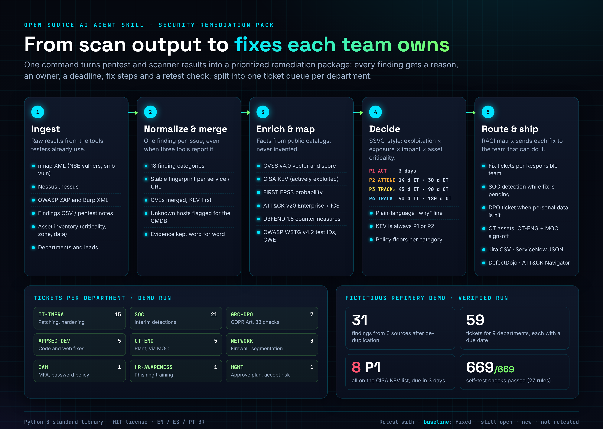
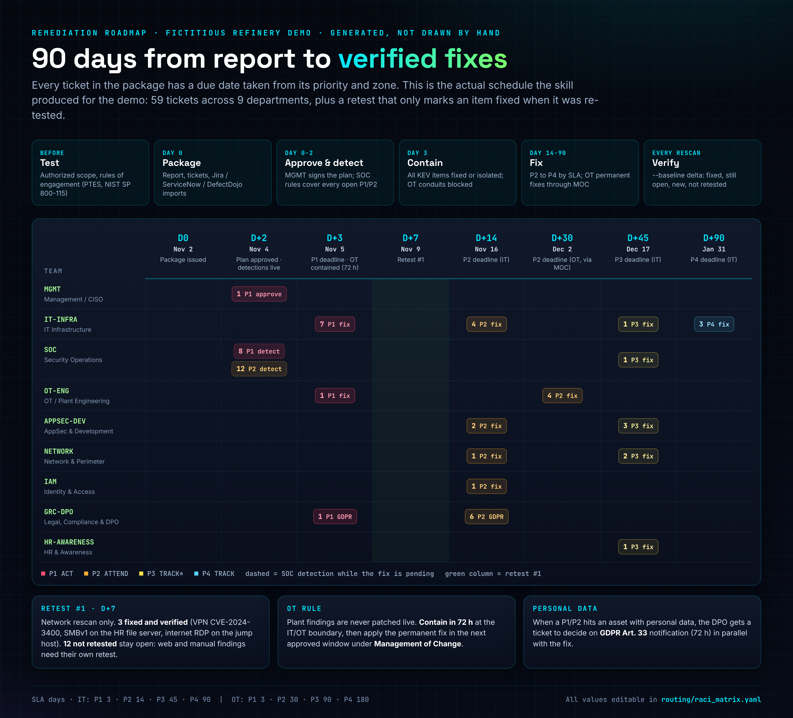
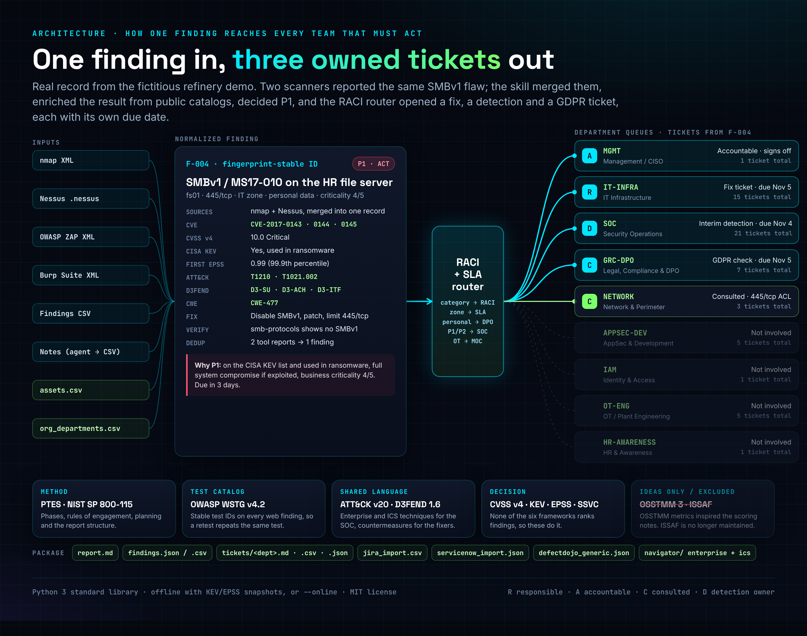

# security-remediation-pack

Languages: **English** | [Español](README.es.md) | [Português (Brasil)](README.pt-BR.md)


An open-source AI agent skill that turns pentest and scanner output into a remediation package every department can act on: one report for management, one ticket queue per team, each finding with a reason, an owner, a deadline, fix steps and a retest check.

A test only pays off when the fix lands. Most reports stop at "here are 31 vulnerabilities". This skill continues to "IT Infrastructure has 7 P1 patches due Thursday, the SOC has 20 interim detections due Wednesday, the DPO has to assess a GDPR notification, and the plant team contains two PLC exposures through Management of Change".



## Quickstart

```bash
git clone {{GITHUB_URL}} security-remediation-pack
cd security-remediation-pack
bash examples/novarefino/run_example.sh      # builds the demo package and runs the self-test
```

Run it on your own results:

```bash
python3 scripts/remediation_pack.py \
  --nmap scan.xml --nessus scan.nessus --zap zap.xml --burp burp.xml --findings manual.csv \
  --assets assets.csv --org org_departments.csv \
  --kev known_exploited_vulnerabilities.json --epss epss.json \
  --company "Example Corp" --scope "External perimeter and corporate LAN" \
  --out out/
python3 scripts/selftest.py out/ --org org_departments.csv
```

- Only the Python 3 standard library. No pip install.
- Works offline with KEV and EPSS snapshots, or pass `--online` to fetch them live.
- `--lang es` or `--lang pt-BR` renders the report and tickets in Spanish or Brazilian Portuguese.
- `--baseline out/findings.json` on a later run produces the retest delta.

To use it as an agent skill, copy the folder into your agent's skills directory. The agent reads [SKILL.md](SKILL.md), which tells it when to use the skill, what to ask for, how to run it and the rules it must follow.

## How it works

1. **Ingest.** Parsers for nmap XML, Nessus, OWASP ZAP, Burp Suite and a generic findings CSV. Pentest notes are turned into that CSV by the agent. An asset inventory adds criticality, zone, internet exposure and data class.
2. **Normalize and merge.** One finding per issue per service, with a stable fingerprint. When nmap and Nessus report the same SMBv1 flaw, you get one finding with two sources, not two tickets.
3. **Enrich and map.** CVSS v4 vector and score, CISA KEV (including ransomware use), FIRST EPSS, MITRE ATT&CK v20 Enterprise and ICS techniques, D3FEND countermeasures, OWASP WSTG v4.2 test IDs and CWE. Missing data is flagged, never invented.
4. **Decide.** An SSVC-style decision (exploitation, exposure, technical impact, asset criticality) gives ACT, ATTEND, TRACK* or TRACK, mapped to P1 to P4. KEV items are always P1 or P2. Every finding gets a plain-language "why" line.
5. **Route and ship.** A RACI matrix ([routing/raci_matrix.yaml](routing/raci_matrix.yaml)) assigns each category to a responsible team, sets the SLA by zone, sends personal-data findings to the DPO, opens an interim SOC detection for open P1/P2 items, and routes OT findings through plant engineering and MOC.



| Priority | Decision | IT SLA | OT SLA |
|---|---|---|---|
| P1 | ACT | 3 days | 3 days (contain in 72 h, permanent fix via MOC) |
| P2 | ATTEND | 14 days | 30 days |
| P3 | TRACK* | 45 days | 90 days |
| P4 | TRACK | 90 days | 180 days |



## What you get

| File | For |
|---|---|
| `report.md` | Management: summary, priority table, the "why" for each finding, department load, retest delta |
| `tickets/<DEPT>.md / .csv / .json` | Each department gets only its own work |
| `findings.json` / `findings.csv` | The full normalized data |
| `jira_import.csv`, `servicenow_import.json`, `defectdojo_generic.json` | Import straight into the tracker you already use |
| `navigator/` | ATT&CK Navigator layers (Enterprise and ICS) showing where the findings sit |

Departments in the default matrix: IT Infrastructure, AppSec/Development, SOC, Identity and Access, Network, OT/Plant Engineering, Legal/Compliance/DPO, HR/Awareness and Management.

## Demo

[examples/novarefino](examples/novarefino) is a fictitious refinery with 19 assets across DMZ, corporate IT and an OT zone. Every number in the images comes from a real run:

- 31 findings from 6 sources after de-duplication, 59 tickets for 9 departments.
- 8 P1, all on the CISA KEV list.
- The retest one week later (network rescan only): 3 fixed and verified, 16 still open, 12 not retested and kept open because their tools were not run again.
- 669/669 self-test checks on the main run.

## Why these frameworks

The skill was designed after comparing the six frameworks in the Cisco NetAcad Ethical Hacker course (1.2.5): MITRE ATT&CK, OWASP WSTG, NIST SP 800-115, OSSTMM, PTES and ISSAF. PTES gives the backbone, NIST SP 800-115 the planning and reporting discipline, WSTG the web test IDs, and ATT&CK with D3FEND the language shared by testers, the SOC and the fixers. None of the six says what to fix first or who owns it, so the skill adds CVSS v4, CISA KEV, FIRST EPSS, SSVC and a RACI matrix. Full comparison in [ANALYSIS.md](ANALYSIS.md).

## Project files

- [SKILL.md](SKILL.md): the skill itself (also in [Spanish](i18n/es/SKILL.md) and [Brazilian Portuguese](i18n/pt-BR/SKILL.md))
- [ANALYSIS.md](ANALYSIS.md): framework comparison and design choices
- [REUSE.md](REUSE.md): survey of existing open-source tools, licenses and what was reused
- [REVIEW_LOG.md](REVIEW_LOG.md): the review rounds and what each one changed
- [NOTICE.md](NOTICE.md): attributions for ATT&CK, D3FEND, WSTG, KEV, EPSS, CVSS, CWE and SSVC
- `scripts/verify_ids.py`: checks every ATT&CK, D3FEND and WSTG ID in the catalog against the official data
- `assets/src/`: HTML sources of the images (`bash assets/src/render.sh how_it_works 1140`)

## Limits

- It does not scan or attack anything. Testing must already have happened under an authorized scope.
- CVSS v4 vectors for categories without a CVE are defaults that the assessor must confirm. The report says so.
- The fix text is generic guidance. Check the vendor advisory before changing production, and never patch live OT systems outside an approved window.

## License

MIT, © 2026 Daniel de Souza Paixão. Framework names and identifiers belong to their owners; see [NOTICE.md](NOTICE.md). The demo company and all its data are fictitious.
