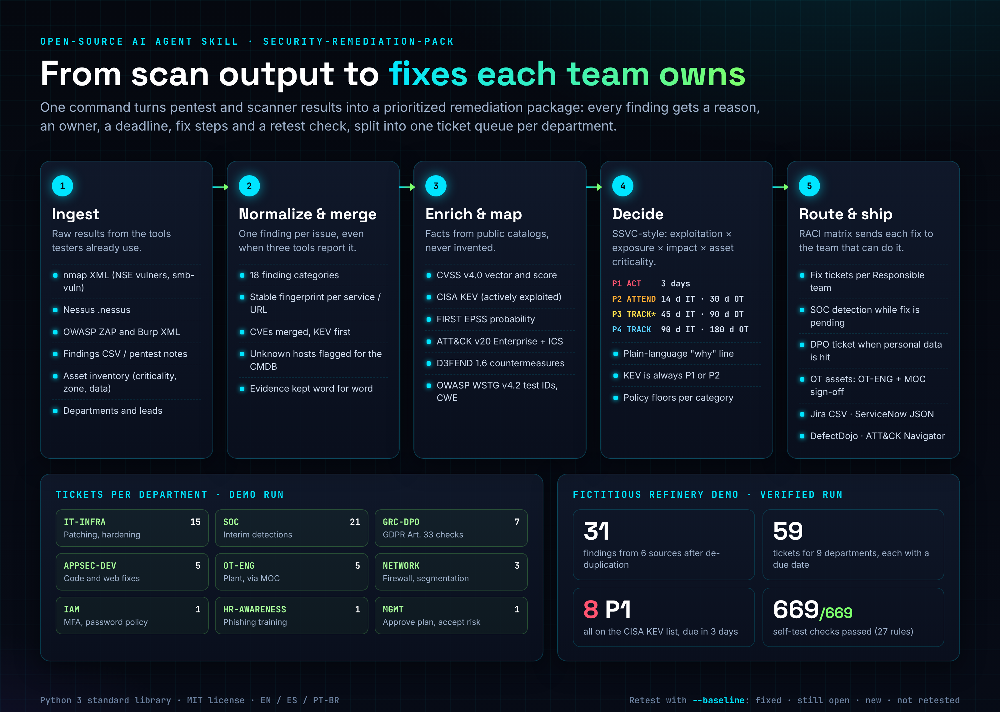
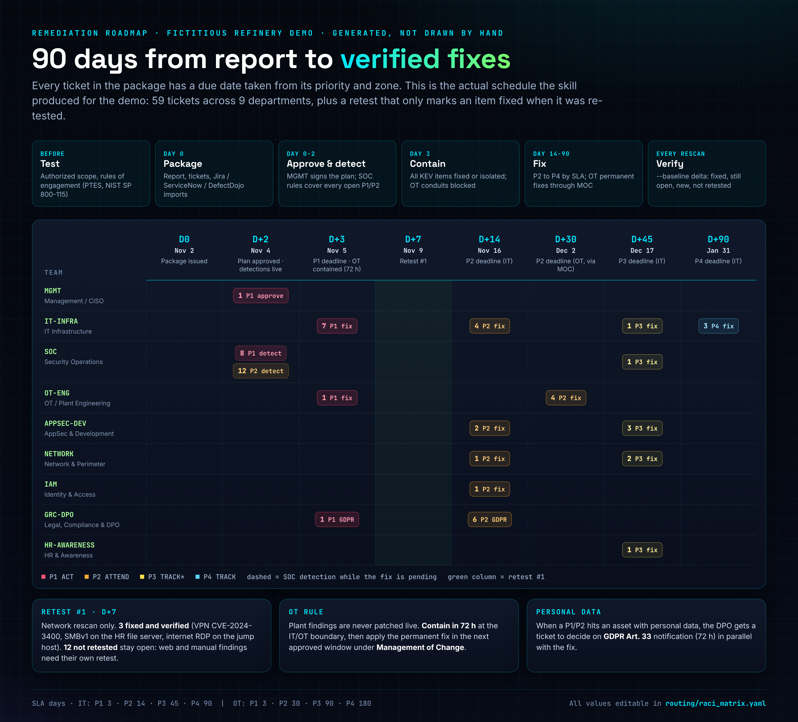
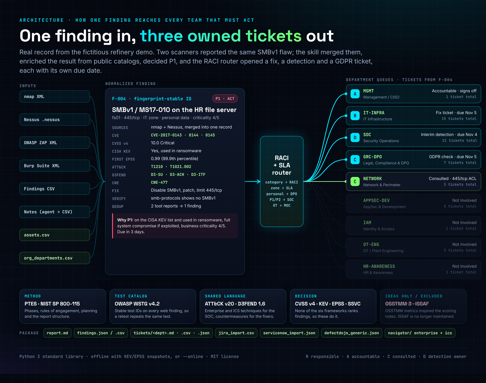

# security-remediation-pack

Idiomas: [English](README.md) | [Español](README.es.md) | **Português (Brasil)**


Uma skill de agente de IA de código aberto que transforma a saída de pentest e de scanners em um pacote de remediação com o qual cada departamento consegue agir: um relatório para a diretoria e uma fila de tickets por equipe, e cada achado com motivo, responsável, prazo, passos de correção e verificação de reteste.

Um teste só vale a pena quando a correção é aplicada. A maioria dos relatórios para em "aqui estão 31 vulnerabilidades". Esta skill vai até "a Infraestrutura de TI tem 7 patches P1 para quinta-feira, o SOC tem 20 detecções provisórias para quarta, o DPO precisa avaliar uma notificação LGPD/RGPD e a equipe da planta contém duas exposições de CLP via gestão de mudanças (MOC)".



## Início rápido

```bash
git clone https://github.com/C48H74/security-remediation-pack security-remediation-pack
cd security-remediation-pack
bash examples/novarefino/run_example.sh      # gera o pacote de demonstração e roda o autoteste
```

Com os seus próprios resultados:

```bash
python3 scripts/remediation_pack.py \
  --nmap scan.xml --nessus scan.nessus --zap zap.xml --burp burp.xml --findings manual.csv \
  --assets assets.csv --org org_departments.csv \
  --kev known_exploited_vulnerabilities.json --epss epss.json \
  --company "Example Corp" --scope "Perímetro externo e LAN corporativa" \
  --lang pt-BR --out out/
python3 scripts/selftest.py out/ --org org_departments.csv
```

- Só a biblioteca padrão do Python 3. Sem pip install.
- Funciona offline com cópias locais de KEV e EPSS, ou com `--online` para buscá-las ao vivo.
- `--lang es` ou `--lang pt-BR` gera o relatório e os tickets em espanhol ou português do Brasil.
- `--baseline out/findings.json` em uma execução posterior gera o delta de reteste.

Para usar como skill de agente, copie a pasta para o diretório de skills do seu agente. O agente lê o [SKILL.md](i18n/pt-BR/SKILL.md), que diz quando usar, o que pedir, como executar e quais regras seguir.

## Como funciona

1. **Ingestão.** Parsers para nmap XML, Nessus, OWASP ZAP, Burp Suite e um CSV genérico de achados. O agente converte as anotações do pentest para esse CSV. Um inventário de ativos traz criticidade, zona, exposição à internet e classe de dados.
2. **Normalização e fusão.** Um achado por problema e serviço, com uma impressão digital estável. Se o nmap e o Nessus reportam a mesma falha SMBv1, você recebe um achado com duas fontes, não dois tickets.
3. **Enriquecimento e mapeamento.** Vetor e nota CVSS v4, CISA KEV (inclusive uso em ransomware), FIRST EPSS, técnicas MITRE ATT&CK v20 Enterprise e ICS, contramedidas D3FEND, IDs de teste OWASP WSTG v4.2 e CWE. Dado ausente é sinalizado, nunca inventado.
4. **Decisão.** Uma decisão no estilo SSVC (exploração, exposição, impacto técnico, criticidade do ativo) gera ACT, ATTEND, TRACK* ou TRACK, convertidos em P1 a P4. O que está no KEV é sempre P1 ou P2. Cada achado tem uma linha de "por quê" em linguagem simples.
5. **Roteamento e entrega.** Uma matriz RACI ([routing/raci_matrix.yaml](routing/raci_matrix.yaml)) atribui cada categoria a uma equipe responsável, define o SLA por zona, envia ao DPO os achados com dados pessoais, abre uma detecção provisória no SOC para P1/P2 em aberto e encaminha os achados de OT para a engenharia da planta e o MOC.



| Prioridade | Decisão | SLA TI | SLA OT |
|---|---|---|---|
| P1 | ACT | 3 dias | 3 dias (conter em 72 h, correção definitiva via MOC) |
| P2 | ATTEND | 14 dias | 30 dias |
| P3 | TRACK* | 45 dias | 90 dias |
| P4 | TRACK | 90 dias | 180 dias |



## O que você recebe

| Arquivo | Para |
|---|---|
| `report.md` | Diretoria: resumo, tabela de prioridades, o "por quê" de cada achado, carga por departamento, delta de reteste |
| `tickets/<DEPT>.md / .csv / .json` | Cada departamento recebe só o próprio trabalho |
| `findings.json` / `findings.csv` | Todos os dados normalizados |
| `jira_import.csv`, `servicenow_import.json`, `defectdojo_generic.json` | Importação direta na ferramenta que você já usa |
| `navigator/` | Camadas do ATT&CK Navigator (Enterprise e ICS) mostrando onde estão os achados |

Departamentos da matriz padrão: Infraestrutura de TI, AppSec/Desenvolvimento, SOC, Identidade e Acesso, Redes, OT/Engenharia de planta, Jurídico/Compliance/DPO, RH/Conscientização e Diretoria.

## Demonstração

[examples/novarefino](examples/novarefino) é uma refinaria fictícia com 19 ativos distribuídos entre DMZ, TI corporativa e uma zona OT. Todos os números das imagens vêm de uma execução real:

- 31 achados de 6 fontes após a deduplicação, 59 tickets para 9 departamentos.
- 8 P1, todos na lista CISA KEV.
- O reteste uma semana depois (só nova varredura de rede): 3 corrigidos e verificados, 16 ainda abertos e 12 não retestados, que continuam abertos porque as ferramentas deles não rodaram de novo.
- 669/669 verificações do autoteste na execução principal.

## Por que estes frameworks

A skill foi desenhada depois de comparar os seis frameworks do curso Ethical Hacker da Cisco NetAcad (1.2.5): MITRE ATT&CK, OWASP WSTG, NIST SP 800-115, OSSTMM, PTES e ISSAF. O PTES dá a espinha dorsal, o NIST SP 800-115 a disciplina de planejamento e relatório, o WSTG os IDs de teste web, e o ATT&CK com o D3FEND a linguagem comum entre testers, SOC e quem corrige. Nenhum dos seis diz o que corrigir primeiro nem quem é o dono, por isso a skill adiciona CVSS v4, CISA KEV, FIRST EPSS, SSVC e uma matriz RACI. Comparação completa (em inglês) em [ANALYSIS.md](ANALYSIS.md).

## Arquivos do projeto

- [SKILL.md](i18n/pt-BR/SKILL.md): a skill (original em [inglês](SKILL.md), também em [espanhol](i18n/es/SKILL.md))
- [ANALYSIS.md](ANALYSIS.md): comparação dos frameworks e decisões de design
- [REUSE.md](REUSE.md): levantamento de ferramentas open source existentes, licenças e o que foi reaproveitado
- [REVIEW_LOG.md](REVIEW_LOG.md): as rodadas de revisão e o que cada uma mudou
- [NOTICE.md](NOTICE.md): atribuições de ATT&CK, D3FEND, WSTG, KEV, EPSS, CVSS, CWE e SSVC
- `scripts/verify_ids.py`: confere cada ID de ATT&CK, D3FEND e WSTG do catálogo contra os dados oficiais
- `assets/src/`: fontes HTML das imagens (`bash assets/src/render.sh how_it_works 1140`)

## Limites

- Não faz varredura nem ataca nada. Os testes precisam ter sido feitos antes, dentro de um escopo autorizado.
- Os vetores CVSS v4 das categorias sem CVE são padrões que o avaliador deve confirmar. O relatório avisa.
- Os passos de correção são orientações gerais. Confira o boletim do fabricante antes de mexer em produção e nunca aplique patch em sistemas OT em operação fora de uma janela aprovada.

## Licença

MIT, © 2026 Daniel de Souza Paixão. Os nomes e identificadores dos frameworks pertencem aos seus donos; veja [NOTICE.md](NOTICE.md). A empresa da demonstração e todos os seus dados são fictícios.
